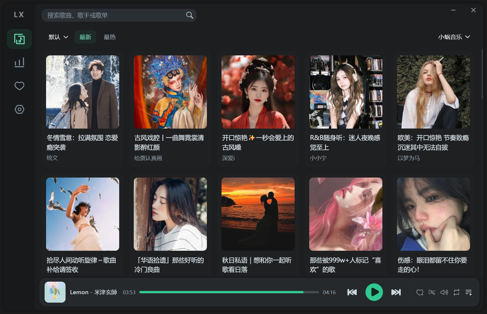
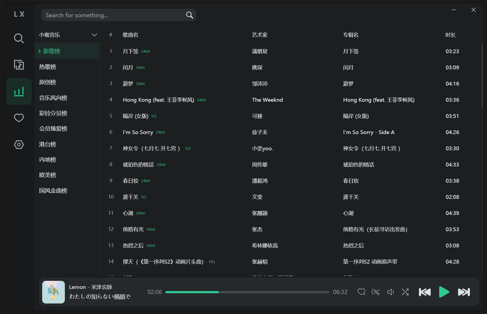
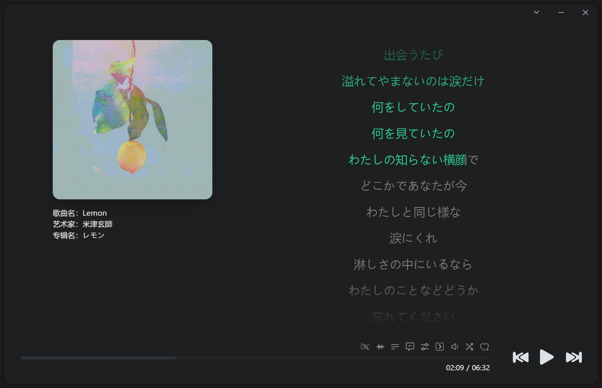
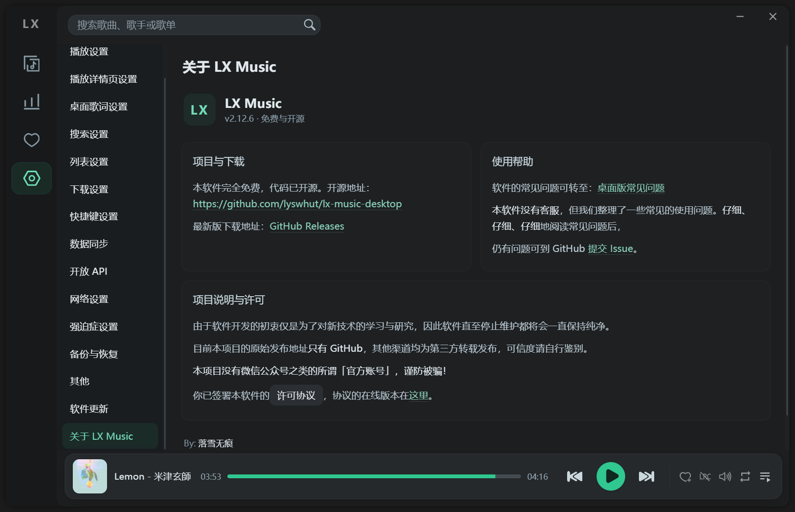

# 🎵 LX Music Fluent Dark

**让洛雪音乐拥有更简洁、更现代的暗色界面。**

LX Music Desktop 第三方界面美化项目，采用炭黑、深灰与薄荷绿配色，融入 Windows 11 Fluent Design 风格。

无需手动配置主题，替换 `app.asar` 即可体验完整美化效果。

## 📥 下载

**最新版本：v1.2.0**

[⬇️ 下载 LX Music Fluent Dark v1.2.0](https://github.com/mousensei/LX-Music-Fluent/releases/latest)

适用平台：Windows  
基础软件：LX Music Desktop 2.12.6

## 📸 界面预览

## ✨ 美化特色

- 🌙 **现代暗色界面**：采用炭黑与深灰配色，整体更加简洁舒适。
- 💚 **薄荷绿强调色**：优化播放按钮、进度条及选中状态。
- 🪟 **Fluent Design 风格**：圆角、柔和阴影与半透明效果。
- 🎵 **播放器美化**：优化播放栏、弹窗及播放界面。
- 🎤 **桌面歌词美化**：优化歌词字体、颜色、布局及显示效果。
- 🎨 **主题整合**：内置完整主题样式，无需手动设置颜色。

## 📦 安装方法

**第一步：下载文件**

前往 [Releases 发布页面](https://github.com/mousensei/LX-Music-Fluent/releases/latest)，下载 `app.asar`。

**第二步：找到安装目录**

1. 完全退出 LX Music，包括系统托盘中的进程。
2. 打开 LX Music 的安装目录。
3. 进入 `resources` 文件夹。

**第三步：替换文件**

1. 找到原版 `app.asar`。
2. 将原文件复制到其他位置进行备份。
3. 将下载的新版 `app.asar` 放入 `resources` 文件夹。
4. 替换原来的 `app.asar`。

**第四步：启动软件**

重新启动 LX Music，即可体验完整的 Fluent Dark 美化界面。

无需额外创建主题，也无需手动调整颜色。

## 🔄 恢复原版

1. 完全退出 LX Music。
2. 打开安装目录下的 `resources` 文件夹。
3. 将备份的原版 `app.asar` 放回。
4. 重新启动软件。

## 📋 更新日志

### v1.1.0

- 优化多个页面的整体视觉效果。
- 美化桌面歌词界面。
- 优化字体、颜色及界面布局。
- 完善暗色主题与薄荷绿配色。
- 整合主题样式，无需用户手动配置。
- 优化整体视觉一致性。

### v1.0.0

- 首个正式版本发布。
- 初步实现 Fluent Dark 暗色界面。
- 优化首页、播放器及排行榜。
- 支持自定义主题颜色。

## ⚠️ 注意事项

- 本项目为第三方 UI 美化项目，与 LX Music 官方无关。
- 目前适用于 LX Music Desktop 2.12.6（Windows）。
- 不保证兼容其他软件版本。
- 软件更新可能覆盖美化文件。
- 替换前请务必备份原版 `app.asar`。

## ❤️ 致谢

感谢 [LX Music Desktop](https://github.com/lyswhut/lx-music-desktop) 原项目及其贡献者。

本项目仅对软件界面进行美化，不改变原项目的归属及版权。
